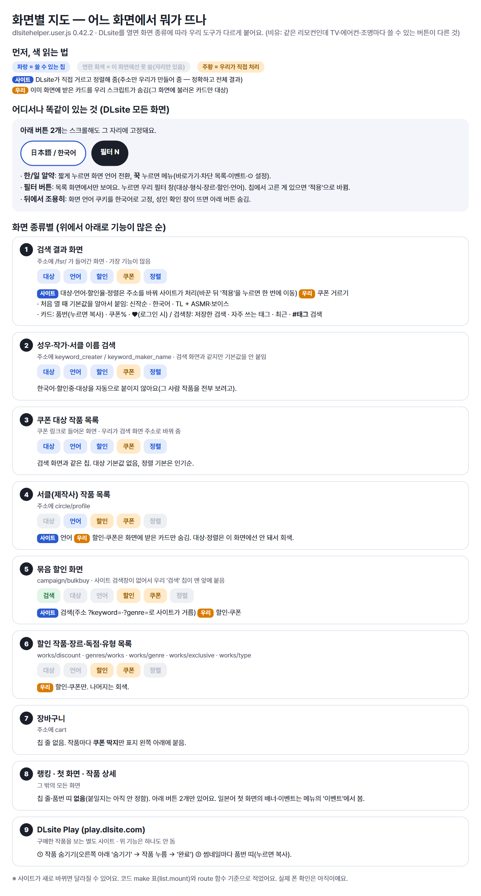
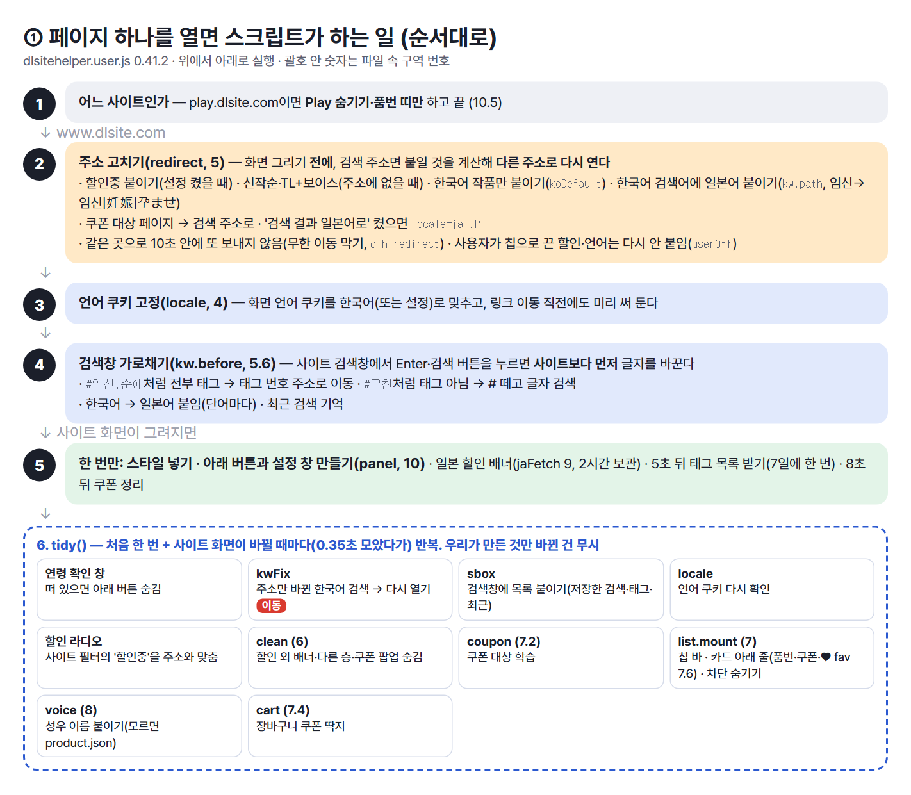
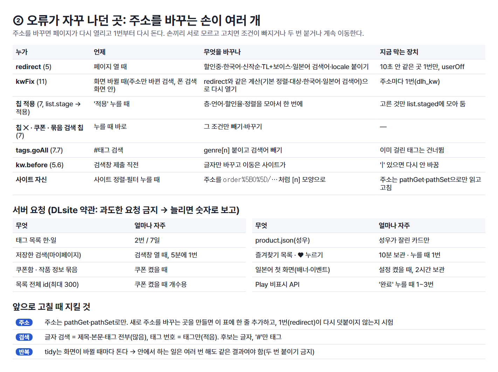

# -...-
바이브 코딩이라 미숙합니다... 버그 제보해주시면 고칠게요🙏🙏
- 맨 아래 html : 설명서
-  dlsite 관련 js는 모두 적용시켜야해요

## 기능 설명 (화면별 지도)
- DLsite 화면 종류마다 어떤 기능이 붙는지 정리한 그림이에요. (dlsitehelper 0.42.2 기준)
- 파랑 = 쓸 수 있는 칩, 연한 회색 = 그 화면에선 못 씀.

## 스크립트 구조 (개발자용)
- 코드가 어떤 부분으로 나뉘고, 주소를 바꾸는 곳이 어디인지 정리한 그림이에요. (0.42.2 기준)

